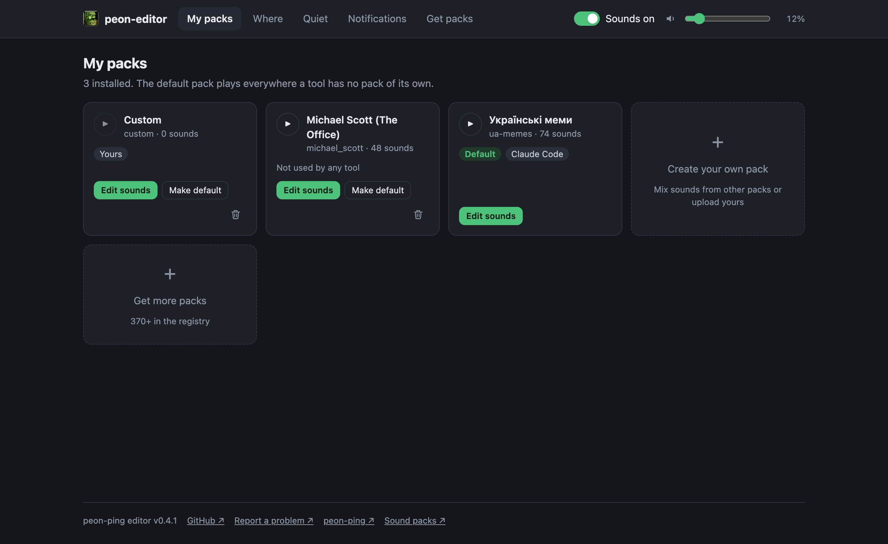
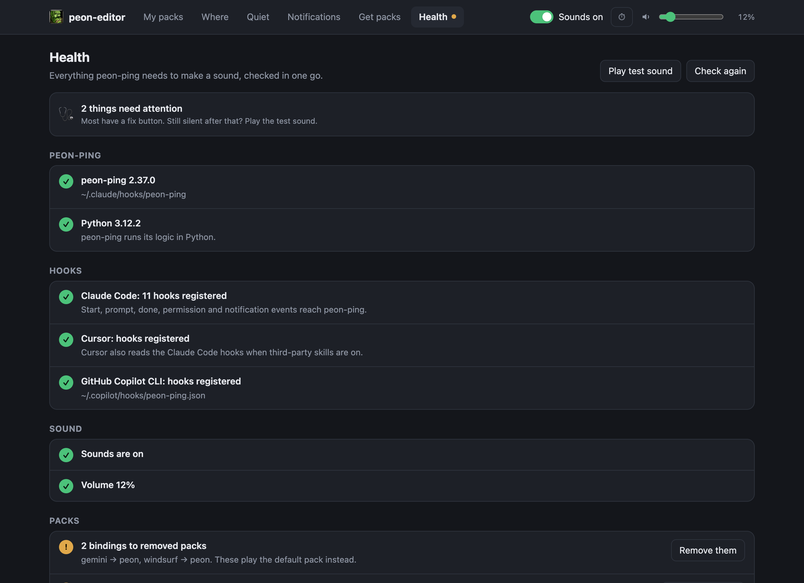

<div align="center">

# 🔔 peon-ping editor

### The missing UI for [peon-ping](https://github.com/PeonPing/peon-ping)

Pick a voice for every AI coding agent, build your own sound packs, style the pop-ups —<br>
and mute it all from the macOS menu bar. No terminal, no JSON.

[](https://github.com/shusachenko/peon-ping-editor/releases/latest)
[](https://github.com/shusachenko/peon-ping-editor/actions/workflows/ci.yml)


[](LICENSE)

**[Install](#-install)** · **[Features](#-what-you-can-do)** · **[Screenshots](#-screenshots)** · **[PeonBar](#-peonbar)** · **[FAQ](#-faq)**

<br>



</div>

<br>

> **peon-ping** plays game-character voice lines — *"Work work!"*, *"Ready to work?"* — when Claude Code, GitHub
> Copilot, Cursor, Codex and other agents finish a task or need you. It is configured from the terminal.
> **peon-ping editor** gives it a proper screen and a menu-bar switch.

## ⚡ Install

```bash
curl -fsSL https://raw.githubusercontent.com/shusachenko/peon-ping-editor/main/install.sh | bash
```

That's it. The editor lands in `~/.peon-editor`, you get a `peon-editor` command, and on macOS **PeonBar** appears in
the menu bar and starts with every login. Open the editor from PeonBar → **Open pack editor…** or run `peon-editor`.

<table>
<tr><td><b>Needs</b></td><td><a href="https://github.com/PeonPing/peon-ping#install">peon-ping</a> and Node.js 18+. The installer tells you if either is missing.</td></tr>
<tr><td><b>Update</b></td><td>PeonBar → <b>Check for Updates…</b>, or run the install command again.</td></tr>
<tr><td><b>Remove</b></td><td><code>bash ~/.peon-editor/app/uninstall.sh</code> — peon-ping, its settings and your packs stay.</td></tr>
</table>

## ✨ What you can do

| | |
|---|---|
| 🎧 **Listen & edit packs** | Every sound grouped by event — *Session start, Task done, Needs your input…* Play, switch off, drag to reorder or into another event |
| 🧩 **Build your own pack** | Start empty or from a copy, pull sounds from any installed pack, upload your own WAV/MP3/OGG/M4A/AIFF |
| 🛠 **A voice per tool** | GLaDOS for Claude Code, Peon for Copilot, StarCraft for Cursor — and a pack per project folder |
| 🤫 **Quiet when it matters** | Silent during calls, in macOS Focus, without headphones, or while you are already looking |
| 💬 **Pop-ups your way** | Classic, Glass, Sakura or Jarvis banners, position, timing, text — with a preview that matches the real thing |
| 📱 **On your phone** | A push via ntfy, Pushover or Telegram when the agent is done and you've stepped away |
| 🛒 **370+ packs** | Browse, preview and install from the peon-ping registry, filtered by language |
| 🍎 **Menu-bar switch** | Mute, volume, default pack and one-click updates; closing a banner stops its sound |
| 🩺 **Health** | Finds why it's silent — hooks, mute, volume, missing files, removed packs — with a fix button, a test sound and a history of what played and why not |
| 🎙 **Record your own** | Record lines straight into your pack; recordings and uploads get silence trimmed and volume evened out |
| 📦 **Share packs** | Export a pack as one `.peonpack.zip`, import one a teammate sent |
| ⏱ **Mute for a while** | 30 min, 1 hour, 2 hours or until tomorrow morning — and a global ⌃⌥⌘M hotkey |
| 🧭 **Setup guide** | Four quick steps for first-time users |
| 🌍 **English / Українська** | Follows your browser, switch in the footer |

Everything stays on your Mac: the editor listens on `127.0.0.1` only and has zero dependencies.

## 📸 Screenshots

<table>
<tr>
<td width="50%"><p align="center"><b>Pack editor</b> — play, switch off, drag sounds around</p></td>
<td width="50%"><p align="center"><b>Where</b> — a pack per tool and per folder</p></td>
</tr>
<tr>
<td><p align="center"><b>Notifications</b> — themes, text and a live preview</p></td>
<td><p align="center"><b>Get packs</b> — 370+ packs, preview before you install</p></td>
</tr>
<tr>
<td><p align="center"><b>Quiet</b> — calls, Focus, headphones</p></td>
<td><p align="center"><b>Health</b> — why it's silent, fixed in one click</p></td>
</tr>
</table>

## 🍎 PeonBar

A tiny native menu-bar app that comes with the installer (macOS 12+, Apple silicon and Intel).

- **Sounds on/off** — the peon dims and gets a red slash when muted
- **Volume** slider that plays a sample when you let go
- **Default pack**, **Open pack editor…**, **Start at login**
- **Check for Updates…** — one click, PeonBar restarts on the new version; it also checks once a day
- **Stops the sound when you close a banner**, so a long line doesn't keep talking
- **Mute for…** 30 min, 1 hour, 2 hours or until tomorrow morning — sounds come back on their own
- **Mute hotkey** ⌃⌥⌘M anywhere (or ⌥⇧⌘M, or off), with a short on-screen "Sounds off / on"

It uses peon-ping's own icon from your install — this repo ships no game artwork.

## 🧠 How it works

The editor changes peon-ping through its own `peon` commands wherever they exist, so peon-ping's adapters for other
tools stay in sync. Where peon-ping has no command, it edits the same keys in `config.json` that the official
`peon-ping-config` skill does.

<details>
<summary><b>Sounds, events and moving sounds around</b></summary>

- **On/off:** `peon sounds enable|disable <event> <file> --pack=<pack>` (`disabled_sounds`); pack files are not touched.
- **Whole events:** `categories` in `config.json` (applies to every pack).
- **Moving and reordering** in downloaded packs edits the pack's `openpeon.json`:
  - your changes are recorded in `peon-editor-moves.json` next to the peon-ping folder and the untouched manifest is kept as `openpeon.json.orig`;
  - if `peon update` overwrites the pack, your changes are applied again next time you open it;
  - packs often reuse one file for several events, so each move remembers where it came from;
  - when everything is back where it was, the manifest is restored byte-for-byte.
</details>

<details>
<summary><b>Your own packs</b></summary>

A regular CESP pack in peon-ping's `packs/` folder (`openpeon.json` + `sounds/`), marked `x_peon_editor_custom`, so the
editor edits it in place. Uploads are checked by their content, not just the extension, and limited to 5 MB; every
file gets a `sha256` like registry packs.
</details>

<details>
<summary><b>Tools, folders and quiet modes</b></summary>

- **Tools:** `peon packs ide-bind <tool> <pack>`, `ide-unbind`, `packs use` (`ide_rules`, `default_pack`).
- **Folders:** `peon packs bind <pack> --pattern <folder>`, `packs unbind --pattern`, `packs exclude add|remove`
  (`path_rules`, `exclude_dirs`). Suggestions come from the project paths in `~/.claude.json` — only the paths are read.
- **Order peon-ping uses:** a pack picked for one chat (`/peon-ping-use`) → folders → tools → rotation → default.
- **Quiet:** `meeting_detect`, `focus_detect` (+ `focus_detect_mode`), `headphones_only`, `suppress_sound_when_tab_focused`.
</details>

<details>
<summary><b>Notifications and phone</b></summary>

- On/off goes through `peon notifications on|off`; style, theme, position, timing, title and message templates are
  written to `config.json`. **Send test** runs `peon notifications test`.
- peon-ping's installer ships only the classic banner; picking Glass, Sakura or Jarvis downloads
  `scripts/mac-overlay-<theme>.js` from the peon-ping release that matches your installed version.
- Phone: `peon mobile ntfy|pushover|telegram …`, `mobile on|off`, `mobile test`. Tokens are stored by peon-ping and
  never sent back to the browser.
- **Stop sound on close:** banners broadcast `com.peonping.dismiss.*` when clicked or closed (not when they time out);
  PeonBar stops the player recorded in `.sound.pid` if it is still `afplay`/`peon-play`.
</details>

<details>
<summary><b>Health and history</b></summary>

- Checks peon-ping and Python, the hooks in Claude Code (`~/.claude/settings.json`), Cursor and Copilot CLI, mute,
  volume, the main events, the default pack, bindings to removed packs, missing sound files, the banner theme,
  PeonBar, and newer versions of peon-ping and the editor. Fix buttons only touch what the editor manages; anything
  else is shown as a command to copy.
- **Play test sound** plays a line from the default pack through `afplay`, even when muted.
- **Recent events** read peon-ping's own debug log (`peon debug on`, pruned after `debug_retention_days`) and show
  what each event played — or why it did not: silent folder, muted, a quiet mode, a repeat, a sub-agent, …
</details>

<details>
<summary><b>Recording, sharing and timed mutes</b></summary>

- **Recording** uses the browser's `MediaRecorder`. Recordings (and uploads, if you leave the box ticked) are decoded,
  mixed to mono, trimmed of leading/trailing silence with short fades, normalised to −1 dBFS and saved as 16-bit WAV.
- **Export** writes `<pack>.peonpack.zip` — `openpeon.json` plus the sound files it uses. **Import** checks the zip
  (CRCs, sizes, at most 500 files / 50 MB, no `../` paths, real audio only), skips macOS `__MACOSX`/`._` files and
  adds the pack as one of your own.
- **Timed mutes** are peon-ping's normal pause plus `.editor-mute-until`; PeonBar and the editor turn sounds back on
  when the time is up.
</details>

<details>
<summary><b>Installer, updates and PeonBar</b></summary>

- `install.sh` runs entirely from a `main()` function, so a cut-off download does nothing; a failed download keeps the
  installed version.
- PeonBar is built locally when Xcode or the Command Line Tools are present, otherwise the universal app is downloaded
  from the [latest release](https://github.com/shusachenko/peon-ping-editor/releases/latest).
- It is started at login by `~/Library/LaunchAgents/com.peonping.peonbar.plist` (shown as *PeonBar* in Login Items).
- **Check for Updates** compares `package.json` on GitHub with the installed one and re-runs the installer in its own
  process group, so it survives PeonBar being replaced.
</details>

## ⚙️ Configuration

| Variable | Default | |
|---|---|---|
| `PEON_DIR` | `~/.claude/hooks/peon-ping` | peon-ping install dir (`CLAUDE_PEON_DIR` and `CLAUDE_CONFIG_DIR` are honoured too) |
| `PEON_EDITOR_MOVES` | `<PEON_DIR>/../peon-editor-moves.json` | where moves and custom order are stored |
| `PEON_BIN` | peon-ping's `peon.sh` | peon CLI; an empty string edits `config.json` directly |
| `PEON_EDITOR_REF` | `main` | branch or tag `install.sh` installs |
| `PEON_EDITOR_HOME` | `~/.peon-editor` | where `install.sh` puts the app |
| `PEON_EDITOR_NO_MENUBAR` | — | `1` skips PeonBar (editor only, e.g. on Linux) |

```
peon-editor [--port 8787] [--pack <name>] [--no-open] [--version] [--help]
```

## ❓ FAQ

<details>
<summary><b>Does it send anything anywhere?</b></summary>

No. The editor talks only to peon-ping on your Mac. It reaches the internet only when you ask it to: browsing or
installing packs (peon-ping's registry and GitHub), downloading a banner theme, checking for updates, or sending a
phone push through the service you set up.
</details>

<details>
<summary><b>Why does "In Focus / Do Not Disturb" need Full Disk Access?</b></summary>

macOS keeps the Focus state in a protected file. The app your agent runs in (Terminal, iTerm, Cursor, VS Code…) needs
Full Disk Access for peon-ping to read it. Without it nothing breaks — peon-ping just keeps playing.
</details>

<details>
<summary><b>Will a peon-ping update wipe my changes?</b></summary>

No. Your own packs are separate folders that peon-ping leaves alone. Switched-off sounds live in peon-ping's
settings, and moved or reordered sounds in downloaded packs are re-applied the next time you open the pack in the editor.
</details>

<details>
<summary><b>Linux? Windows?</b></summary>

The editor runs anywhere peon-ping and Node 18+ do (`PEON_EDITOR_NO_MENUBAR=1` on Linux). PeonBar and banner themes
are macOS-only. Windows isn't supported yet.
</details>

## 🧑‍💻 Development

```bash
git clone https://github.com/shusachenko/peon-ping-editor && cd peon-ping-editor
npm start          # run the editor from the checkout
npm test           # node:test, no dependencies
bash install.sh    # install this checkout instead of downloading
```

**Releasing:** bump `version` in `package.json`, tag `vX.Y.Z` and push — GitHub Actions runs the tests and publishes a
release with a universal `PeonBar.zip`. PeonBar's update check picks up the new version.

Issues and pull requests are welcome.

## 📄 License

[MIT](LICENSE) © Serhii Husachenko

<sub>Not affiliated with PeonPing. peon-ping, its sound packs and their characters belong to their respective owners.</sub>
